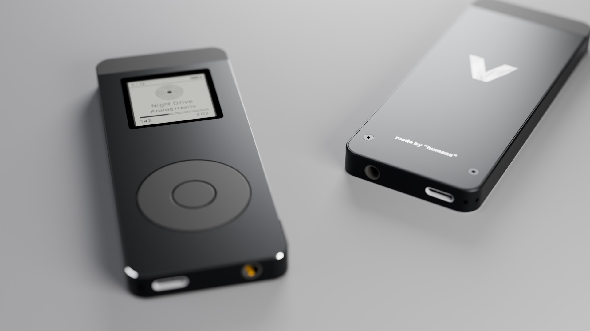
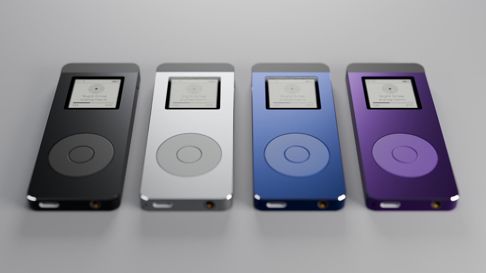
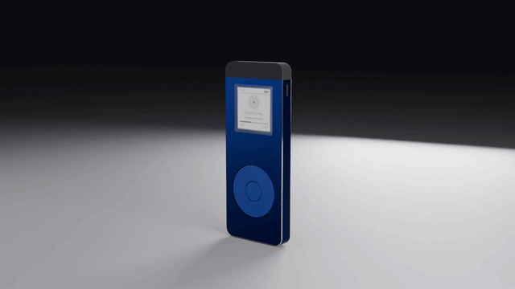
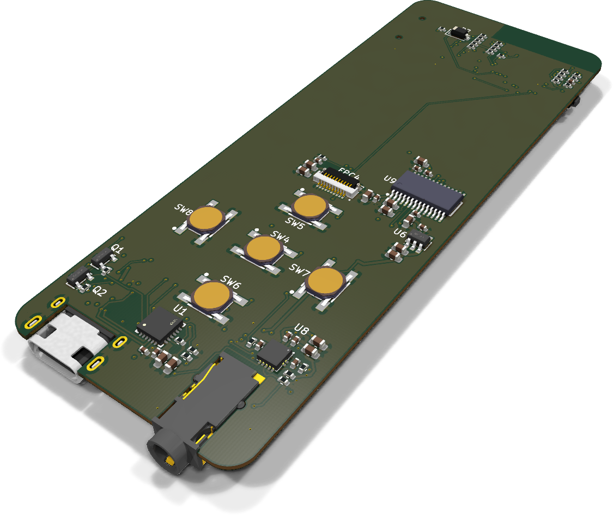
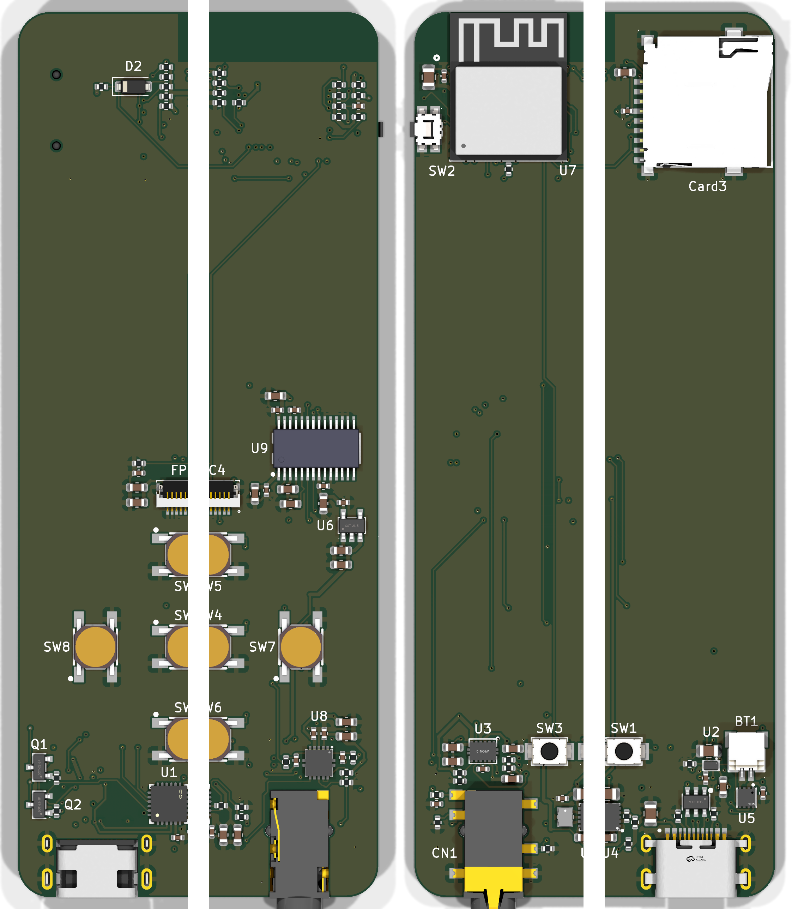

# mp3-player


A modern hi-fi music player with a retro look. It plays FLAC/WAV through a proper DAC and headphone amp, streams to Bluetooth headphones, and has a reflective display you can read in direct sunlight.

<p align="center">
  
</p>
<p align="center"><sub>41 × 101.9 × 8 mm, milled 6061 aluminium with a polished diamond-cut front edge, flush click wheel and cover glass, 3D printed antenna cap. Laser marked on the back.</sub></p>

## Enclosure

<p align="center">
  
</p>
<p align="center">
  
</p>
<p align="center"><sub>Rendered in Blender from the real model: the case parts from <code>enclosure/case.py</code> and the routed board exported from KiCad.</sub></p>

- **Body**: one tub milled from 6061, open at the back; front, sides and both ends in one piece
- **Back**: 0.7 mm aluminium plate on a 0.1 mm adhesive gasket, two M1.6 Torx screws; the top edge is held by the antenna cap
- **Antenna cap**: 3D printed, slides onto the top end like a pen cap (no metal over the ESP32 antenna)
- **Ports**: USB-C and the 3.5 mm jack sit in tight cutouts (0.1 mm around), about 0.2 mm under the bottom face
- **Checked against the board**: `enclosure/check.py` tests every case part against the real board STEP for collisions

## PCB

<p align="center">
  
</p>
<p align="center">
  
</p>
<p align="center"><sub>4-layer, 38.2 × 99.6 × 0.8 mm. Front: click wheel switches, display connector, DAC, headphone amp, USB-UART. Back: ESP32 module and microSD at the top, battery in the middle, charger, 3.3 V buck-boost and ± rails at the bottom.</sub></p>

## Highlights

- **Hi-fi audio path**: PCM5122 DAC (112dB, 32-bit/384kHz) → OPA1622 headphone amp powered from clean ± rails
- **FLAC / WAV / MP3** from a push-push microSD card
- **Bluetooth A2DP** to wireless headphones (classic ESP32)
- **3.5mm jack with plug detection**
- **Sunlight-readable display**: Sharp LS013B7DH03 memory LCD, crisp in direct sun and almost zero power
- **Soft power**: one button wakes the player from ship mode, and the ESP32 turns it off
- **USB-C**: charging, programming via USB-UART with auto-reset, and ESD protection
- **Real battery percentage** from a MAX17048 fuel gauge

## How it works

```
USB-C ─ ESD ─┬─ CP2102N ── ESP32-PICO-MINI-02
             └─ BQ25180 charger ── TPS63802 3.3V digital
                                ├─ LP5907 3.3V analog
                                └─ LM27762 ± rails
ESP32 ── I2S ── PCM5122 ── OPA1622 ── 3.5mm jack
      ├─ SDMMC ── microSD
      ├─ SPI ── display
      └─ BT ── headphones
```

Full architecture, BOM with JLCPCB stock/prices, who-solders-what, cost estimate and design notes are in **[mp3_player.md](mp3_player.md)**.

## Specs (planned)

| | |
|---|---|
| MCU | ESP32-PICO-MINI-02 (8MB flash, 2MB PSRAM) |
| DAC | PCM5122, hardware volume over I2C |
| Headphone amp | OPA1622 |
| Storage | microSD, 4-bit SDMMC |
| Display | Sharp LS013B7DH03 1.28" 128x128 memory LCD |
| Battery | LiPo pouch LP403759, 1000 mAh (4 mm thin) |
| Wireless | Bluetooth A2DP (SBC) |
| Board | 4-layer, 0.8 mm, assembled by JLCPCB + hand-soldered connectors |
| Case | CNC aluminium, anodized (titanium for v2), 41 × 101.9 × 8 mm |
| Prototype cost | ~$200 for 2 assembled boards (double-sided JLC assembly, checked 2026-11-19) |

## Repo layout

```
mp3_player.md         project documentation (start here)
mp3_player.kicad_*    KiCad 10 project
lib/                  symbols, footprints, 3D models (generated from LCSC parts)
datasheets/           datasheets for every chosen part
connections.md        pin-by-pin schematic connections and datasheet review
code.md               firmware notes
enclosure/            case model (build123d): case.py, check.py, full.py, Blender render scripts
images/               PCB and product renders
mp3_player.tex/.pdf   printable writeup
```

## Status

- [x] Requirements, architecture, BOM
- [x] KiCad libraries + datasheets
- [x] Schematic (5 sheets: USB, power, ESP32, audio, I/O)
- [x] Case concept (parametric model, two variants)
- [x] Final case model (milled unibody, collision-checked against the board) + photoreal renders
- [x] PCB: placement, routing (4 layers, DRC clean), silkscreen
- [x] Fab files (Gerbers, drill, JLC BOM + CPL)
- [ ] Order (re-check stock first)
- [ ] Firmware (`arduino-audio-tools` + `ESP32-A2DP`)

## License

[MIT](LICENSE) for the design files and documentation in this repo. Datasheets in `datasheets/` belong to their manufacturers. Footprints and 3D models in `lib/` were generated from EasyEDA/LCSC data.
